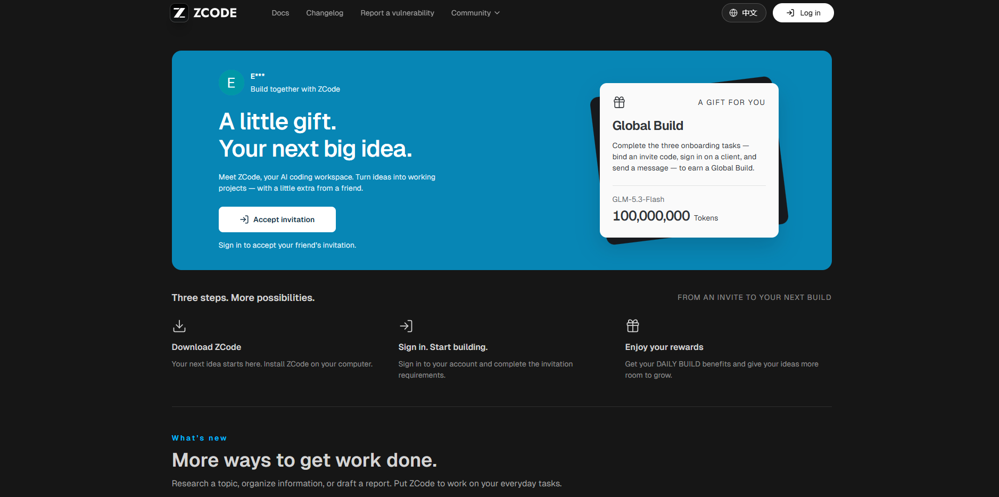
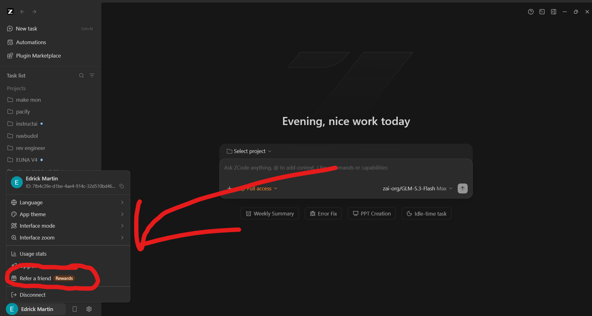
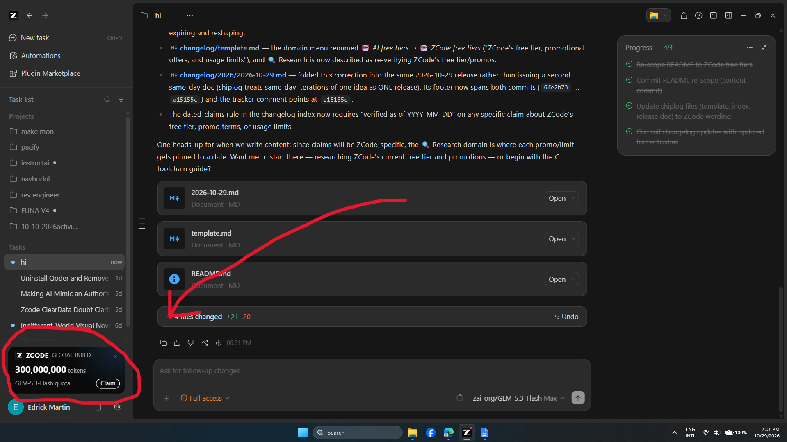
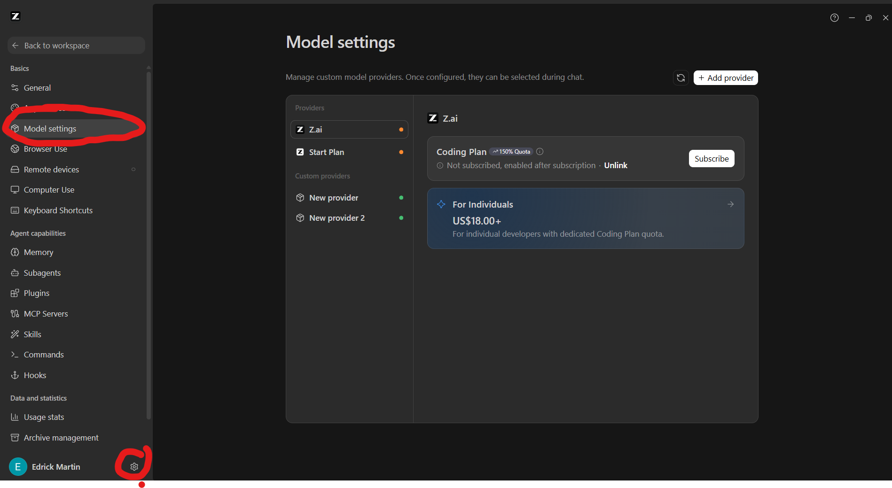
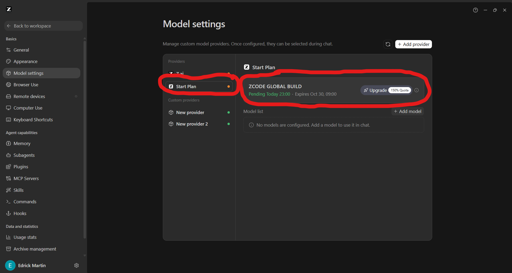
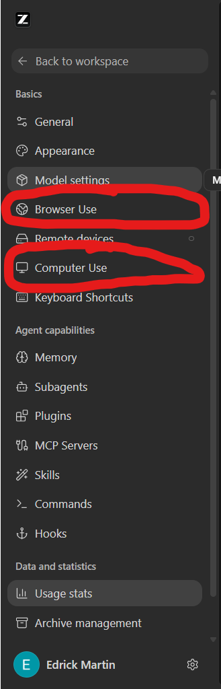

# ZCode setup guide — free offers on GLM-5.3 Flash

ZCode is basically Codex, but since it's a Chinese model it comes with
promotional offers. This guide sets up the ZCode desktop app and claims every
free offer currently available — no card, no subscription.

> **Verified as of 2026-10-29.** Claim windows and token amounts change often;
> the times below are what the app showed on that date.

## What you can get for free

| Offer | What you get | When to claim | When you can use it |
| --- | --- | --- | --- |
| **Global Build** | 300M tokens every day | Every day, roughly **7pm–10pm** — claim before it's gone | Same night, **11pm–9am**. Leftovers are wiped at 9am. |
| **Weekend Build** | 300M tokens every weekend | Sometime **Friday night** (it varies) | The whole weekend — usually **Saturday 11pm to Monday 9am** |
| **Referral sign-up** | 100M tokens for the next 2 days | Once, when you sign up via an invitation link | Every night, 11pm–9am |
| **Referral rewards** | 300M tokens the next week | After 2 friends sign up via your link | — |

The model behind all of this is **GLM-5.3 Flash**. Even if it's a Flash
model, it's still good — it's the same model as OX ALPHA that blew up months
ago.

On the cards, these offers appear as claimable token quotas — 300M for the
Build cards, 100M for the onboarding and referral bonuses — shown as
*GLM-5.3-Flash quota*.

---

## Step 1 — Sign up via the invitation link

Open the invitation link and accept it:

**<https://zcode.z.ai/invite/Z6DTRAFM>**

> [!NOTE]
> This is not to farm my own credits. Signing up via an invitation gives you
> Global Build for the next 2 days.

If you'd rather skip the invitation incentives, download ZCode directly from
**[ZCode — Official Harness for GLM-5.3](https://zcode.z.ai/en)**.

*The invitation page — accepting it starts the three-task flow that earns the
100,000,000-token Global Build gift.*

## Step 2 — Install and log in

Install it on your laptop — that should be easy.

If you followed the invitation steps, log in with your email and it should
direct you to open the code when done.

## Step 3 — Finish the onboarding tasks

Inside ZCode, finish the onboarding tasks to get the **100M tokens** — it's
easy and takes only a minute. There are three simple tasks:

1. **Do the onboarding** — you can just click skip.
2. **Chat one time** — just say hi to the AI.
3. I forgot, but it's easy.

*The account menu — "Refer a friend" is where the Rewards live, and where
you'd grab your own invite link later.*

## Step 4 — Claim the cards

Claim the cards — they appear in the **bottom-left corner**.

*The Global Build card: 300,000,000 tokens of GLM-5.3-Flash quota, with a
Claim button. If cards didn't appear, FULLY close the app and open it again.
Different cards may show up depending on the time.*

> [!IMPORTANT]
> Global Build (as shown in the sample image) is often given away between
> **7pm and 10pm**, so claim it in time before it's gone. It's claimable
> every day during that window, usable that same night from **11pm to 9am** —
> and any leftover tokens are wiped at 9am.

## Where to see the offers you received

Click the **settings gear** (bottom-left) → **Model settings**.

*Model settings — the Z.ai provider shows your Coding Plan state ("not
subscribed, enabled after subscription"), with the paid For Individuals plan
from US$18.00+ below it.*

*Under the Start Plan provider, a claimed Global Build shows exactly when you
can use it — "Pending Today 23:00 · Expires Oct 30, 09:00" — and the total of
remaining tokens.*

## Bonus: built-in browser use and computer use

ZCode ships with two extra agent tools:

1. **Browser Use**
2. **Computer Use**

Enable them in Settings → **Browser Use** / **Computer Use**.

*Both toggles live in the same settings sidebar, right under Model settings.*

## Quick reference — the two consistent promos

Two promos show up reliably as of 2026-10-29:

- **Global Build** — 300M tokens every day.
  - Claimable around 7pm–10pm.
  - Usable 11pm–9am.
- **Weekend Build** — 300M tokens every weekend.
  - Claimable sometime Friday night (it often varies).
  - Usable the entire weekend — usually Saturday 11pm to Monday 9am.
